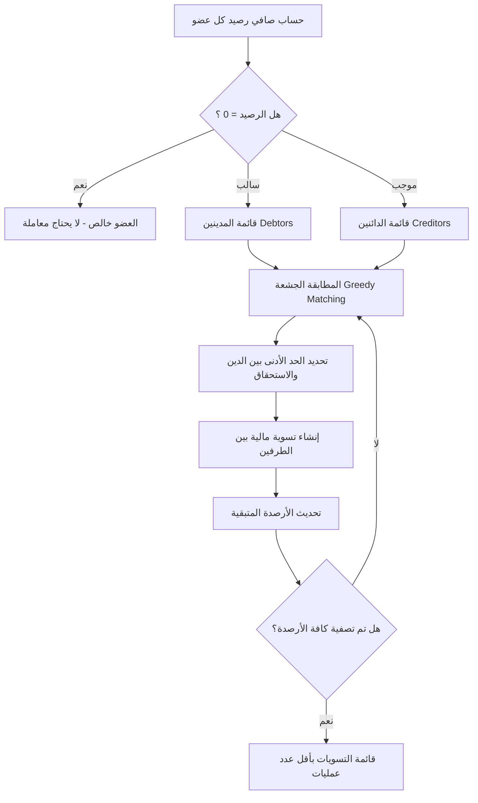

# 🪙 تطبيق العزبة | Al3zba
### نظام إدارة المصاريف المشتركة والتسويات المالية الذكية (Flutter)

<div align="center">


<p align="center">
  <b>حل برمجي متكامل ومحلي بالكامل لإدارة وحساب مصاريف السكن المشترك، الرحلات، والعائلات بدقة محاسبية فائقة، مع خوارزمية تسوية ديون ذكية وتصدير تقارير PDF رسمية مطابقة للدفاتر المحاسبية.</b>
</p>

[المميزات](#-المميزات-الرئيسية) •
[المعمارية البرمجية](#-المعمارية-البرمجية-والتصميم) •
[خوارزمية التسوية](#-خوارزمية-التسوية-المالية-debt-settlement-algorithm) •
[التقنيات المستخدمة](#-التقنيات-وحزم-العمل-tech-stack) •
[البنية الهيكلية](#-الهيكل-البرمجي-للشفرة) •
[دليل التشغيل](#-التثبيت-والتشغيل)

---
</div>

## 📌 نبذة عن المشروع (Project Overview)

تطبيق **العزبة (Al3zba)** صُمم ليحل مشكلة التخبط والحسابات اليدوية المعقدة في السكن المشترك (سكن الطلاب، الموظفين، أو مصاريف الرحلات والعوائل). يقوم التطبيق بأتمتة كامل الدورة المحاسبية بدءاً من تقييد الفواتير، وحساب الحصص بطرق مرنة، وحتى الوصول إلى أقل عدد من المعاملات المالية المطلوبة لتسوية ديون الجميع، مع إمكانية طباعة كشف حساب ورقي بصيغة PDF ومشاركته بضغطة زر.

> 🔒 **خصوصية تامة (Offline-First)**: جميع البيانات تُحفظ مشفرة محلياً على جهاز المستخدم دون الحاجة للاتصال بالإنترنت، وبدون جمع أي بيانات شخصية.

---

## ✨ المميزات الرئيسية (Key Features)

### 1. 👥 إدارة الأعضاء والشركاء
* إضافة وتعديل وحذف أي عدد من الأعضاء بكل مرونة.
* تعيين عضو باسم **"البيت"** لحساب المصاريف المشتركة العامة أو الأرصدة الافتتاحية.
* إمكانية تسجيل رصيد سابق (موجب أو سالب) لكل عضو يُدمج تلقائياً في التسويات.

### 2. ⚡ محرك تقسيم المصاريف الذكي (Smart Expense Split Engine)
يدعم التطبيق 3 نماذج مرنة لتقسيم أي فاتورة أو بند صرف:
* **متساوي للجميع (`equalAll`)**: توزيع التكلفة آلياً بالتساوي على كل الأعضاء.
* **متساوي لمختارين (`equalSelected`)**: اختيار مجموعة فرعية فقط من الأعضاء لتحمل التكلفة دون البقية.
* **مبالغ مخصصة (`customAmounts`)**: تخصيص قيمة محددة لكل عضو وفق استهلاكه الفعلي.

### 3. ⚖️ خوارزمية تسوية الديون المثلى (Optimized Debt Settlement)
* احتساب صافي المركز المالي لكل عضو بدقة سنت/قرش:
  $$\text{Net Balance} = (\text{Total Paid} - \text{Total Share}) + \text{Initial Balance}$$
* خوارزمية جشعة (Greedy Matching Algorithm) تفرز الدائنين والمدينين وتُنتج **أقل عدد ممكن من الحوالات** لإنهاء الديون.
* كشف تسوية تفصيلي لكل بند يوضح سبب كل مبلغ بين أي عضوين.

### 4. 📄 تصدير ومعاينة كشوفات PDF المحاسبية
* محرك توليد PDF مدمج يعيد رسم "دفتر الحسابات الورقي التقليدي" بتصميم عصري وأنيق.
* دعم خطوط عربية مدمجة بالكامل (**RB Font** بأوزانه 300, 400, 700) لمنع أي تشويه أو تقطع في النصوص العربية داخل الـ PDF.
* يشمل التقرير: جدول بنود الصرف وحصص الأعضاء، ملخص الدفعيات، وجدول التسويات والتوقيعات الرسمية.
* معاينة مباشرة داخل التطبيق مع أزرار للطباعة الفورية عبر شبكة Wi-Fi أو التصدير كملف.

### 5. 📊 واجهات عرض مزدوجة (Cards & Data Table)
* **عرض البطاقات (Cards View)**: تصفح سهل ومريح على شاشات الهواتف مع تفاصيل كل بند.
* **عرض الجدول المحاسبي (Matrix Grid View)**: جدول أفقي ورأسي يوضح توزيع كل ريال على كل عضو في شاشة واحدة.

### 6. 💬 التكامل والمشاركة الفورية
* توليد رسالة نصية منسقة بملخص الديون والمبالغ المطلوبة لمشاركتها مباشرة عبر **WhatsApp** أو تطبيقات التواصل الاجتماعي بنقرة واحدة.

---

## 🏗️ المعمارية البرمجية والتصميم (Software Architecture)

تم بناء التطبيق باتباع مبادئ **Clean Code** وفصل المسؤوليات (**Separation of Concerns**) مع معمارية قائمة على الطبقات:

```
┌─────────────────────────────────────────────────────────────┐
│                    Presentation Layer                       │
│     Screens (HomeScreen, PdfPreviewScreen)                  │
│     Widgets (ExpenseCards, ExpenseTable, SettlementView)   │
└──────────────────────────────┬──────────────────────────────┘
                               │ State Listening & UI Events
┌──────────────────────────────▼──────────────────────────────┐
│                    State Management Layer                   │
│         EzbaProvider (ChangeNotifier / Reactive)            │
└──────────────────────────────┬──────────────────────────────┘
                               │ Orchestrates Business Logic
┌──────────────────────────────▼──────────────────────────────┐
│                     Domain & Logic Layer                    │
│    EzbaPeriod • ExpenseItem • Member • Settlement Models    │
│    Algorithms: Debt Minimization & Share Calculations       │
└──────────────────────────────┬──────────────────────────────┘
                               │ Persistence & I/O
┌──────────────────────────────▼──────────────────────────────┐
│                      Services Layer                         │
│  StorageService (SharedPreferences) • PdfService (Printing)  │
└─────────────────────────────────────────────────────────────┘
```

### 🎯 أبرز أنماط التصميم المطبقة:
* **Provider Pattern**: لإدارة حالة التطبيق بشكل تفاعلي ومنع إعادة بناء الواجهات غير الضرورية.
* **Repository/Service Pattern**: عزل التعامل مع التخزين المحلي والـ PDF في خدمات منفصلة تسهل الاختبار والمحاكاة (Mocking).
* **Immutability & Pure Functions**: نماذج البيانات غير قابلة للتعديل المباشر (`immutable`) وتعتمد على دالة `copyWith` لضمان استقرار الحالة وتفادي الـ Side Effects.

---

## 🧮 خوارزمية التسوية المالية (Debt Settlement Algorithm)

تعتمد عملية تصفية الحسابات على تحويل مسألة الديون إلى رسم بياني ثنائي الأطراف (**Bipartite Graph Matching**) وحلها عبر الخوارزمية التالية:



---

## 🛠️ التقنيات وحزم العمل (Tech Stack)

| التقنية / الحزمة | الإصدار | الوظيفة ودواعي الاستخدام |
| :--- | :---: | :--- |
| **Flutter SDK** | `^3.8 / >=3.19` | إطار العمل الأساسي لبناء تطبيق متعدد المنصات بأداء عالي |
| **Dart** | `^3.8.1` | لغة البرمجة الأساسية مع دعم كامل لـ Sound Null Safety |
| **provider** | `^6.1.2` | إدارة الحالة بكفاءة وتوصيل البيانات بالواجهات |
| **pdf** | `^3.11.2` | إنشاء وتخطيط مستندات PDF ثنائية الأبعاد برمجياً |
| **printing** | `^5.14.0` | طباعة المستندات ومشاركتها ومعاينتها داخل التطبيق |
| **shared_preferences**| `^2.5.2` | حفظ واسترجاع بيانات الفترات والمصاريف على الذاكرة المحلية |
| **share_plus** | `^10.1.4` | مشاركة نصوص التسويات عبر قنوات التواصل (واتساب، تيليجرام) |
| **intl** | `^0.20.2` | تنسيق الأرقام والعملات والتواريخ باللغة العربية |
| **flutter_lints** | `^5.0.0` | التحقق من جودة الكود والالتزام بأفضل ممارسات Dart الرسمية |

---

## 📂 الهيكل البرمجي للشفرة (Directory Structure)

```text
al3zba/
├── android/                 # ملفات بناء بيئة الأندرويد
├── assets/
│   └── font/                # خطوط RB العربية المدمجة (Light, Regular, Bold)
├── lib/
│   ├── main.dart            # نقطة البداية، تهيئة الـ Provider والـ RTL
│   ├── models/              # كائنات البيانات ونماذج الحسابات
│   │   ├── expense_item.dart   # نموذج بند الصرف ونوع التقسيم
│   │   ├── ezba_period.dart    # نموذج الفترة المحاسبية وخوارزميات الحساب
│   │   ├── member.dart         # نموذج بيانات العضو والأرصدة
│   │   └── settlement.dart     # نماذج التسويات والمعاملات الناتجة
│   ├── providers/
│   │   └── ezba_provider.dart  # مزود الحالة وإدارة دورة حياة المصاريف
│   ├── screens/             # الشاشات الرئيسية
│   │   ├── home_screen.dart        # الشاشة الأساسية ومتابعة الفترات
│   │   └── pdf_preview_screen.dart # شاشة معاينة التقرير والطباعة
│   ├── services/            # الخدمات ومصادر البيانات
│   │   ├── pdf_service.dart        # محرك رسم مستند الـ PDF بالكامل
│   │   └── storage_service.dart    # خدمة التخزين والاسترجاع المحلي
│   ├── theme/               # سمات التطبيق، الألوان، وتهيئة الخطوط
│   │   └── app_theme.dart
│   ├── utils/               # دوال مساعدة لتنسيق المبالغ والتواريخ
│   └── widgets/             # مكونات الواجهة القابلة لإعادة الاستخدام
│       ├── add_expense_dialog.dart    # نافذة إضافة بند صرف جديد
│       ├── expense_cards_view.dart    # عرض المصاريف على هيئة بطاقات
│       ├── expense_table_view.dart    # جدول البيانات المحاسبي الشبكي
│       ├── manage_members_dialog.dart # نافذة إدارة الأعضاء والشركاء
│       ├── members_summary_view.dart  # بطاقة ملخص أرصدة كل عضو
│       ├── period_selector_sheet.dart # شيت إدارة وتصفير الفترات
│       └── settlement_view.dart       # واجهة تصفية وحساب الديون
├── test/
│   ├── ezba_test.dart       # اختبارات الوحدة للحسابات وخوارزميات التقسيم
│   └── widget_test.dart     # اختبارات واجهة المستخدم الأساسية
└── pubspec.yaml             # إعدادات المشروع والمكتبات
```

---

## 🚀 التثبيت والتشغيل (Getting Started)

### المتطلبات الأساسية
* تثبيت **Flutter SDK** بإصدار `3.19.0` أو أحدث.
* بيئة تشغيل مدعومة: **Android Studio** أو **VS Code** مع إضافات Flutter & Dart.

### خطوات التثبيت:

1. **استنساخ المستودع (Clone Repository):**
   ```bash
   git clone https://github.com/Abdullah-Bashaaib/al3zba.git
   cd al3zba
   ```

2. **تثبيت الحزم البرمجية (Dependencies):**
   ```bash
   flutter pub get
   ```

3. **تشغيل التطبيق (Run Project):**
   ```bash
   # للتشغيل على جهاز أندرويد متصل أو محاكي
   flutter run -d android

   # للتشغيل على متصفح الويب (Chrome)
   flutter run -d chrome
   ```

---

## 🧪 الاختبارات وضمان الجودة (Testing & QA)

تم تصميم النظام مع تغطية شاملة باختبارات الوحدة للتأكد من سلامة العمليات الحسابية:

```bash
flutter test
```

### الحالات المختبرة في `test/ezba_test.dart`:
* ✅ صحة إنشاء الفترات التلقائية والأعضاء الافتراضيين.
* ✅ حسابات التقسيم المتساوي (`Equal Split`) وتطابق النواتج الرياضية بدون كسور مهملة.
* ✅ حسابات التقسيم المخصص والاختياري (`Selective & Custom Split`).
* ✅ سيناريوهات سداد الأعضاء واختبار استخراج التسويات المالية الصافية.

---

## 🎨 المعايير التصميمية (Design & Typography)

* **RTL-First Design**: تم تصميم الواجهات بالكامل من اليمين إلى اليسار لتوفير تجربة طبيعية للمستخدم العربي.
* **Custom Typography**: استخدام خط **RB** المدمج بجميع أوزانه يمنح التطبيق هوية بصرية مريحة واحترافية.
* **Material 3 Theming**: تناسق لوني حديث يراعي التباين والراحة البصرية وسهولة تمييز المبالغ (دائن باللون الأخضر، مدين باللون البرتقالي/الأحمر).

---

## 📄 الترخيص (License)

هذا المشروع مرخص ومتاح للاستخدام تحت رخصة **[MIT License](LICENSE)**.

---

<div align="center">

**تطوير المهندس:** عبد الله بشايب  
🌐 [GitHub Profile](https://github.com/Abdullah-Bashaaib)

⭐ إذا أعجبك المشروع ووجدته مفيداً، لا تنسَ ترك نجمة على المستودع!

</div>
